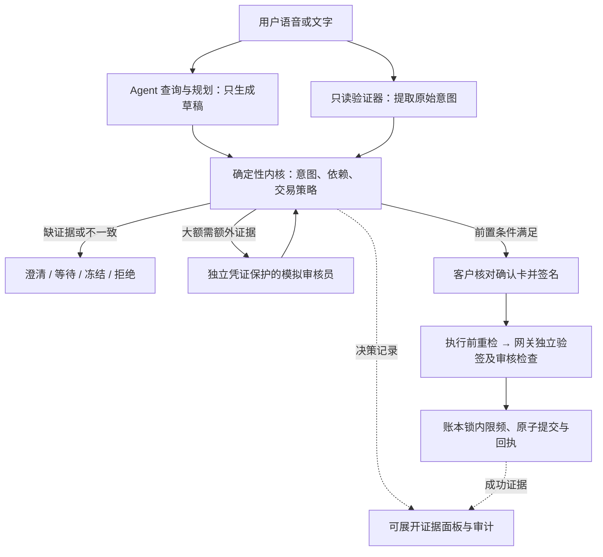

# Star：可执行的交易安全契约

核心贡献：AI 可以提出交易，但意图、计划依赖、授权内容和执行条件必须通过代码检查，并留下可复核证据。
这是一套模拟银行中的确定性风控框架，不是新训练的信用评分模型，也不宣称银行级绝对安全。



## 四条原则及可验证证据

| 原则 | 执行检查 | 展示与测试 |
|---|---|---|
| 忠实于用户意图 | 独立提取金额、对象、资产和来源；不一致冻结 | 用户原话、AI 草稿、验证结果并排展示 |
| 计划依赖成立 | 前序草稿 ID 绑定进签名卡；内核和网关检查该客户的成功账本回执 | 未完成前序交易时无法签名；不能用其他客户的回执 |
| 批准内容一致 | 客户设备签名绑定卡片摘要；网关独立验签与防重放 | 改金额、对象或依赖 ID 后旧签名失效 |
| 执行时仍安全 | 执行前重检；账本锁内限频；大额交易需要独立模拟审核 | 签名后余额变化、频率窗口满或审核过期均不能继续 |

`app/kernel/contract.py` 产生统一决策记录，含 policy_version、stage、action、checks、reason_codes、
required_evidence、验证器模式及审核证据。内核的新增依赖和审核门禁直接使用该记录；既有语义、
风控及签名门禁继续由原模块执行。HTTP 拒绝也记录原因。成功记录与交易回执一起原子持久化。

交易依赖 ID 属于客户签名卡；风险决策解释属于服务端观察，不属于客户签署的风险评估。
回执的普通 SHA-256 不是独立第三方对审核员身份或决策真实性的认证。服务端仍在信任边界内。

## 风险与处置

- 意图不一致：冻结，不给当前草稿签名。
- 验证缺失：等待验证，不能授权。
- 依赖未执行：拒绝；重新确认用户请求。
- 达到默认 10 分钟 3 笔的窗口：拒绝新交易，窗口释放后重新发起。支付和投资在账本写锁内再次检查，
  包括内部转账；历史计数持久化。幂等重试不会消耗新名额。定期指令仅登记计划，不代表已执行未来扣款。
- 超过当前保护等级金额阈值的对外交易（含账单、投资、定期指令登记）：需模拟银行审核。
  内部账户互转不触发此项。默认 Enhanced 为 S$1,000，Standard 为 S$3,000；原有硬上限仍有效。
- 冷静期、额外问题、模拟审核、设备签名是不同条件，不能互相替代。
- 签名无效、重放或执行前风险升级：拒绝。

## 启动和角色分离

```powershell
pip install -r tests/requirements.txt
python -m app.serve
```

客户在 localhost:8000 使用原来的聊天和确认卡。安全证据默认折叠，保持客户主流程简洁。
进入 Security lab，点击 **Run risk demonstration**，即可运行完整的隔离演示；无需配置审核口令或在线模型。

要演示客户的真实大额审批闭环，在 `.env` 配置 `SECONDARY_REVIEW_KEY` 为独立随机口令，重启服务。
可通过 `python -c "import secrets; print(secrets.token_urlsafe(32))"` 生成，只交给模拟银行审核员。
没有配置时审核接口返回 REVIEW_DISABLED，大额交易保持阻断；不会自动跳过审核。

1. 客户输入 `Send 1500 to my daughter`，在确认卡下载 review-ticket.json。
2. 审核员使用**另一个浏览器配置文件或无痕窗口**打开应用，进入 Security lab → Simulated bank review desk。
3. 输入审核员口令，上传客户票据，点击 Inspect pending transaction。先核对原话、金额、对象、账户和卡片摘要。
4. 点击 Approve as simulated bank reviewer。审核有效期最长五分钟，且不能超过草稿有效期。
5. 客户点击 Check approval status；待其他检查通过后仍须亲自签名，才会执行。

审核接口必须同时具备独立口令和准确票据。口令不进入模型工具、localStorage、决策记录或回执；界面查看后清空口令框。
审批绑定客户、会话、草稿、摘要和策略版本；取消时撤销、成功后移除。重启丢失待审核状态，必须重新发起。
审核接口限速。票据包含会话凭证，只交给可信审核员，不要公开展示完整票据或口令。

这只是用不同操作者凭证模拟带外角色，不是实际硬件令牌、独立银行通道或客户经理回拨。
部署仍应使用 HTTPS。KYC、原始音频归档和真实银行接入不在本次实现范围。

## 五分钟答辩演示

1. 说明四条安全契约：AI 只提议，确定性代码决定能否继续。
2. 正常转 S$50：客户签名；展开证据，展示等待状态如何变为已执行，并下载回执。
3. Security lab → Run risk demonstration：逐一打开错误金额、错误收款人、未完成前序任务。
   指向实际失败检查和 **Ledger debit: S$0.00**。
4. 展示签名后改金额和余额变化：先前授权不会让错误条件继续执行。
5. 展示大额缺审批和频率窗口满，再解释对照表与测量边界。

八个案例在新的模拟银行中实际运行内核、设备签名和网关。为隔离缺审批这个条件，
该案例仅在沙箱夹具里令冷静期已过；客户服务没有跳过冷静期的接口。
余额变化案例由夹具外部修改余额，报告区分外部变化和本次交易的实际扣款。

## 对照评测的准确表述

界面的 A/B/C 表是**五个固定候选交易的检查结果重放**：

- A：只考虑签名准备，不检查交易策略、语义或依赖；
- B：增加交易策略硬限制；确认问题假定用户回答 Yes，不能算作拦截；
- C：再增加语义和依赖门禁。

记录每一候选是否会进入授权。这里没有运行一个放宽安全控制的线上银行，也没有要求真实用户批准错误交易。
测试集有四个故障和一个正常控制；结果不是真实模型准确率、群体风险率或用户误伤率。
八个实际内核场景与五个候选重放是两种不同证据，不能相加为独立安全用例数。
离线验证器共享解析器，界面明确标注；真实模型对照、正常用户摩擦、口音识别和延迟基准需要另做研究。

## 复跑

```powershell
python -m unittest discover tests
python eval/run_eval.py
python eval/run_contract_eval.py
```

最后一条生成 `eval/contract-report.json` 并在场景不符合预期时返回非零退出码。
浏览器测试：安装 Node 的 playwright 包并安装 Microsoft Edge 后运行 `node qa/run_contract_browser.cjs`。
可用 NODE_PATH 指向已有 Playwright，PYTHON 指向带项目依赖的 Python。它启动独立服务、临时账本和独立客户／审核员会话，
输出 `qa/results/contract-browser.json` 与桌面、手机截图，不调用在线模型或 ASR。
